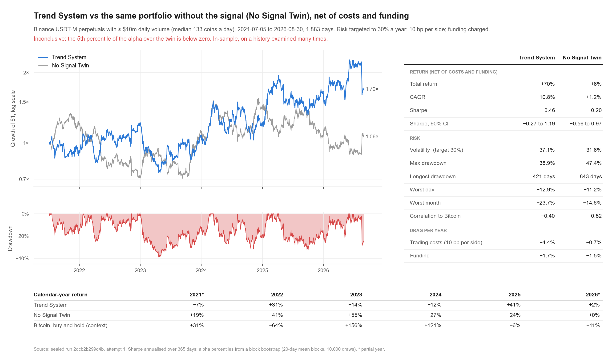
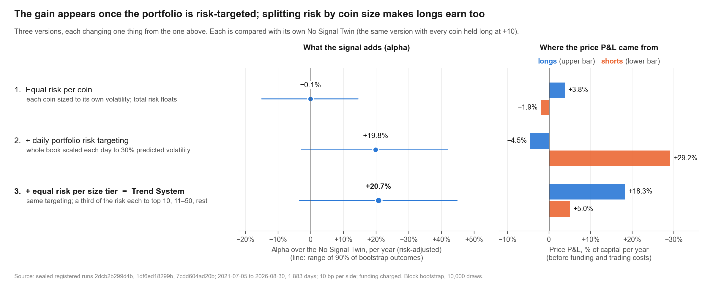
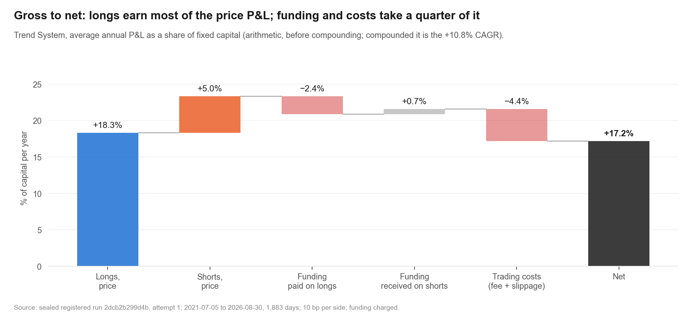
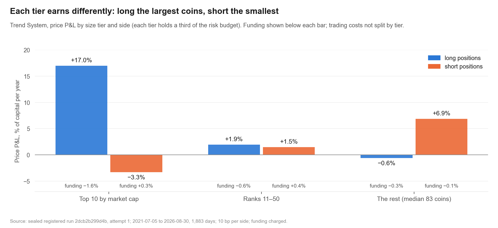

# Trend Following on Crypto Perpetual Futures, Net of Costs

*A pre-registered test of a Carver-style trend system on Binance USDT-M perpetuals, 2021–2026.*

> **About 12 minutes to read. This box is the one-minute version.**
>
> - **The question:** does trend following make money in crypto once trading costs and funding are paid?
> - **What I found:** on its own, the trend signal showed no edge over the same portfolio without it. Once the whole portfolio was also scaled each day to a fixed level of risk, it earned 10.8% a year against 1.2% for that portfolio (net Sharpe ratio 0.46), a risk-adjusted gain (alpha) of about +20% a year.
> - **The catch:** the result is inconclusive. The pessimistic end of the alpha estimate is still below zero, and the history behind it had been studied many times.
> - **What's next:** a forward test on live data.

 

## Why I Did This

In 2025, while I was still at university, I made a significant amount of money trading crypto. Whether that was luck or a real edge, I couldn't say: it was all gut feeling, with no way to test the intuition behind it. After a few hectic months, and after graduating, I decided to learn the scientific way to test an idea in a market. Crypto was the market I knew best, so I set out to learn backtesting from first principles.

 

## The Approach

The question started with Scott Phillips' conversation on *Flirting with Models* ("Finding Ugly Edges in Crypto Markets", March 2025), and grew into a year-long research project built on Robert Carver's *Systematic Trading*.

My first backtest was a single trend rule on Bitcoin. From there I tested the question in registered stages, from a single signal on a top-10 basket to per-coin trend across up to 275 coins a day. Each of those stages was pre-registered: rules, parameters and the pass/fail test were fixed and hashed before the first run. Each per-coin strategy was judged against its own No Signal Twin, the same portfolio with the trend signal removed, over 2021-07-05 to 2026-08-30 with 10 bp per side and funding charged.

**Key terms**

| term | meaning |
|---|---|
| Perpetual future (perp) | a futures contract with no expiry date, traded with leverage |
| Funding | a payment between longs and shorts at every settlement that keeps a perp's price close to the coin's; when positive, longs pay shorts |
| Basis point (bp) | 0.01%; 10 bp per side is 0.10% of each trade's value |
| Sharpe ratio | annual return divided by annual volatility: return per unit of risk |
| No Signal Twin | the same portfolio with every coin's forecast fixed at +10 (always long); comparing the two shows what the trend signal adds |
| Alpha | the risk-adjusted gain over the No Signal Twin: the part of the system's return not explained by its exposure to the twin, estimated by regression |
| Portfolio risk targeting | scaling every position up or down together each day so the whole portfolio's predicted volatility is 30% a year |

 

## Results at a Glance

 

## How I Got Here

**Learning (December 2025 to April 2026).** I started with a single trend rule on Bitcoin, mostly to learn how a backtest works: loading data, building a signal, sizing a position, plotting an equity curve. From there I added a breakout rule, a few more coins, and then a rolling top-10 and later top-30 universe ranked by market cap. Most of that period was generating charts and learning what I didn't know.

**Finding the flaws (June 2026).** The early results looked good: a net Sharpe ratio of 0.42 on the rolling universe. Checking them showed why they couldn't be trusted:

- **Survivorship bias.** The universe was built from coins that still trade today, so coins that collapsed or were delisted were missing. A trend system that never meets a coin going to zero looks better than it is.
- **The signal wasn't timing anything.** Splitting the signal's predictive power showed it came almost entirely from picking coins that were already winners, not from timing when to be in or out. Within a single coin, the signal called the direction 49.7% of the time: a coin flip (an earlier diagnostic, not part of this repository).

The 0.42 was void. Rather than patch the old backtest, I started again.

**Getting serious (September to November 2026).** I rebuilt the project around one rule: decide everything before looking at the result.

- **Data:** every USDT-M perpetual in Binance's public archive as of October 2026 (900 contracts, including the delisted ones), daily market caps from 2020, funding at every settlement, and a register explaining every gap.
- **Pre-registration:** each test had its rules, parameters and pass/fail test written down and hashed before the first run, and every registered variant was counted (64 trials). The early experiments and the exploratory work below are not in that count.
- **A fair comparison:** each strategy was judged against its No Signal Twin, so the test measures what the trend signal adds.

**Where risk targeting came from.** After the per-coin runs came back empty, I looked at what a stronger system did differently. OctopusTakopi's open-source crypto trend system reports a Sharpe ratio of about 1.0, and their engine on my data reproduced it (0.96), which suggests the data wasn't the difference; their construction was. Three choices explain most of the gap: a lower liquidity floor ($5m vs my $10m), risk weights by correlation cluster, and, the biggest, daily portfolio risk targeting. With my forecasts in their engine, removing risk targeting took the Sharpe ratio from 0.53 to 0.04. This was exploratory, so I registered risk targeting as a new trial before testing it.

The registered runs, in order:

| stage | what changed | net Sharpe | alpha over twin, per year | verdict |
|---|---|---|---|---|
| Basket | one signal on a cap-weighted top-10 basket | 0.04 | +1.2%* | null |
| Per-coin, top 10 | each coin its own signal, long and short | −0.09 | +0.7% | inconclusive |
| Per-coin, top 25 / top 50 | more coins | −0.12 / −0.06 | +0.0% / +0.6% | inconclusive |
| Per-coin, all ≥ $10m | every liquid coin (median 133 a day) | −0.03 | −0.1% | fail |
| Risk-targeted | + daily portfolio risk targeting | 0.50 | +19.8% | inconclusive |
| **Trend System** | + equal risk per size tier | **0.46** | **+20.7%** | inconclusive |

* The basket was compared with buy-and-hold of the same basket and run without the one-day lag; with the lag its alpha was −1.0%. Its run is also flagged as not formally registered, because the code was not committed when it ran.

 

Adding coins didn't change the result. In this sequence, the gain appeared once risk targeting was added. The last two stages were each designed after the earlier results were known, which is why each counts as a new trial and why none of this replaces a forward test.

 

## The System

The Trend System is the final stage of the project, one of 64 counted trials. Every parameter below was taken from Carver or fixed in the pre-registration before the first run; none was estimated from this data.

### Timing

Positions held over day D are decided from data available at 00:00 UTC on day D−1: daily opens up to that moment, and trading activity from the last completed day (D−2). Trades fill at the open of day D, one full day later.

### Universe

- **Contracts:** every USDT-M perpetual in Binance's public archive as of October 2026 (900 contracts, including those later delisted), minus 209 non-crypto underlyings (stablecoins, gold, FX, equity indices).
- **Liquidity:** a contract is eligible if its median daily Binance quote volume, over its traded days in the 30 days ending on the last completed day, is at least $10m, with at least 20 traded days in that window.
- **Traded on the last completed day:** volume above zero and at least 23 of 24 hourly mark prices present.
- **Size:** a median of 133 eligible coins a day (range 80–275).

### Volatility

An exponentially weighted (EWMA) standard deviation of daily returns, span 32 days, annualised over 365 days, floored at the 5th percentile of its own past 500 days.

### Signal

Four moving-average crossovers, from fast (8 and 32 days) to slow (64 and 256 days), each turned into a forecast between −20 and +20 and then blended into one.

Show the math

For each speed:

$`\displaystyle f_{s} \;=\; \text{clip}\left(\, k_{s} \,\cdot\, \frac{\text{EWMA}_{\text{fast}}(P) \;-\; \text{EWMA}_{\text{slow}}(P)}{P \,\cdot\, \sigma_{\text{daily}}} \,,\quad -20 \,,\quad 20 \,\right)`$

 

| speed (fast / slow) | 8 / 32 | 16 / 64 | 32 / 128 | 64 / 256 |
|---|---|---|---|---|
| forecast scalar $k_s$ | 5.3 | 3.75 | 2.65 | 1.87 |

 

The speeds are averaged, multiplied by a forecast diversification multiplier (FDM) and clipped again:

$`\displaystyle f \;=\; \text{clip}\left(\, \text{FDM}_{n} \,\cdot\, \frac{1}{n} \sum_{s=1}^{n} f_{s} \,,\quad -20 \,,\quad 20 \,\right)`$

 

| speeds available ($n$) | 1 | 2 | 3 | 4 |
|---|---|---|---|---|
| $\text{FDM}_n$ | 1.00 | 1.04 | 1.09 | 1.15 |

 

A forecast of +10 is an average-strength long, −10 an average-strength short. A speed switches on once the coin has traded for twice its slow span (64, 128, 256 and 512 days), and a coin gets no forecast before 64 traded days.

### Risk budget by coin size

Each day, eligible coins are ranked by the previous day's CMC market cap and split into three tiers: ranks 1–10, ranks 11–50, and the rest (including coins outside CMC's top 100). Each tier gets an equal share of the risk budget, split equally among its coins. This is the budget each position is sized from, not the risk each tier ends up contributing: coins move together, so realised risk shares differ.

Show the math

$`\displaystyle w_i \;=\; \frac{1}{K} \,\cdot\, \frac{1}{N_{\text{tier}(i)}}, \qquad \text{tier}(i) \;=\; \begin{cases} 1 & \text{market-cap rank } 1\text{–}10 \\ 2 & \text{market-cap rank } 11\text{–}50 \\ 3 & \text{all other eligible coins} \end{cases}`$

 

where $K$ is the number of non-empty tiers (normally 3) and $N_{\text{tier}(i)}$ the number of eligible coins in coin $i$'s tier. The equal split follows Carver's handcrafting: equal weight across groups, then equal within. The tier boundaries reuse the project's earlier universes (top 10, top 50) and were not tuned.

### Portfolio risk targeting

Each day the system builds a draft book from the forecasts and risk budgets, predicts how much that whole book would move in a year, and scales every position by the same multiplier so the book aims at the target.

Show the math

**1. Draft each position** from its forecast, risk budget and volatility (a share of capital; negative is short):

$`\displaystyle u_i \;=\; \frac{f_i}{10} \,\cdot\, w_i \,\cdot\, \frac{\tau}{\sigma_i}`$
 

**2. Predict the draft book's risk** over a year, allowing for how the coins move together (median 14%):

$`\displaystyle V(u) \;=\; \sqrt{u^{\top}\,\Sigma\,u} \;=\; \sqrt{\sum_{i}\sum_{j} u_i \, u_j \, \rho_{ij} \, \sigma_i \, \sigma_j}`$

In words: add up every pair of positions, each pair weighted by how volatile the two coins are and how closely they move together ($\rho_{ij}$, set to $\bar\rho$ for every pair and 1 for a coin with itself), then take the square root. $u^{\top}\Sigma\,u$ is the matrix shorthand for that double sum.
 

**3. Find the multiplier** that brings the book to the 30% target (median 2.1, no upper limit):

$`\displaystyle M \;=\; \frac{\tau}{V(u)}`$
 

**4. Scale every position** by the same multiplier, before the buffer and caps:

$`\displaystyle x_i^{*} \;=\; M \, u_i`$

 

| symbol | meaning | value in this system |
|---|---|---|
| $f_i$ | forecast for coin $i$ (from the Signal step) | −20 to +20 |
| $w_i$ | coin $i$'s risk budget (from the size tiers) | sums to 1 across coins |
| $\sigma_i$ | coin $i$'s own annual volatility (from the Volatility step) | rebuilt daily |
| $\tau$ | target volatility of the whole portfolio | 30% a year |
| $\Sigma$ | covariance of the coins: $\sigma_i^2$ on the diagonal, $\bar\rho\,\sigma_i\sigma_j$ off it | rebuilt daily |
| $\bar\rho$ | average pairwise correlation of daily returns over the past 180 days, floored at 0 | about 0.55 |

 

The draft book usually runs well below 30%: forecasts are rarely all at full strength, and longs and shorts partly offset. The multiplier scales it back up. When signals are weak or offsetting the book is levered up; when they are strong and aligned it is scaled down. Because the multiplier has no ceiling, a book of weak forecasts that all point the same way can be scaled up sharply (the largest multiplier in the sample was about 29). Realised volatility came in at 37%, above the 30% target, partly because the predicted risk uses one average correlation for every pair and misses sudden market-wide moves.

### Buffer

To avoid trading on small changes, each coin has a no-trade band around its target. If the current position is inside the band, nothing is traded; if it is outside, the system trades only to the nearest edge of the band, not all the way to the target.

Show the math

$`\displaystyle \text{band}_i \;=\; x_i^{*} \;\pm\; 0.10 \,\cdot\, w_i \,\cdot\, \text{IDM} \,\cdot\, \frac{\tau}{\sigma_i}, \qquad \text{IDM} \;=\; \min\left(2.5,\ \frac{1}{\sqrt{1/N + (1 - 1/N)\,\bar\rho}}\right)`$

 

The band is 10% of the coin's standard position (its position at a forecast of +10 before the multiplier $M$), where $N$ is the number of eligible coins and IDM is Carver's instrument diversification multiplier.

A coin is not traded on a day it is untradable; a coin that drops out of the universe is closed at the next fill.

 

### Caps

Two hard limits apply after the buffer:

| limit | rule | how often it bound |
|---|---|---|
| per coin | no position larger than 50% of capital, long or short | 3.6% of days |
| gross exposure | the sum of all positions, long plus short, at most 3× capital; above that, every position is scaled down by the same factor | 3.5% of days |

 

### Costs and funding

- **Trading costs:** 10 bp per side on the value of every trade (5 bp fee plus 5 bp slippage), charged on each leg. They averaged 4.4% of capital a year. At 20 bp per side the Sharpe ratio falls from 0.46 to 0.34.
- **Funding:** perpetual futures pay or receive funding at every settlement (normally every 8 hours). It is charged on each position from Binance's published funding rates, as a holding cost rather than a trading cost. Net funding cost 1.7% a year (longs paid 2.4%, shorts received 0.7%).
- **Missing funding is never filled with zero.** Every gap in Binance's funding history (491 in all) is listed in a register with the evidence for it; only two kinds are charged zero (settlements the exchange skipped, and the hours after a contract's final settlement), and any unlisted gap stops the run.
- **Delistings:** a contract that is settled and delisted is closed at the average of the 30 one-minute index prices before settlement, with a 5 bp fee. Binance used a 60-minute average until November 2024 and 30 minutes since; the 30-minute rule is applied throughout, so earlier settlements are an approximation.

 

## Decomposition

Two choices shape the system: how risk is split across coins, and whether the whole portfolio is scaled each day to a target. Three versions, each registered and run on its own with the same coins, dates, costs and funding, compare them:

| version | how risk is split | whole book scaled daily to 30% | net Sharpe | No Signal Twin Sharpe |
|---|---|:---:|---|---|
| 1. Equal risk per coin | equally across coins | | −0.03 | 0.04 |
| 2. + daily portfolio risk targeting | equally across coins | ✓ | 0.50 | 0.04 |
| 3. + equal risk per size tier = **Trend System** | a third to each size tier | ✓ | **0.46** | 0.20 |

 

In this ordered comparison, the gain appeared when portfolio risk targeting was added. It is not a clean causal test: each step also changes leverage, turnover and funding, not just the sizing rule. A plausible reason it matters: without it, each coin is sized on its own and the book's total risk drifts, so when signals are weak or longs and shorts offset, the book runs at low risk and the signal's bets are too small to beat costs. Splitting risk by coin size barely changes the alpha (+20.7% vs +19.8% a year), but it changes where it comes from. With equal risk per coin, all the money came from shorts (longs −4.5% a year, shorts +29.2%); with risk split by size, both sides earn (longs +18.3%, shorts +5.0%).

 

Before any charges, the Trend System earned 23.3% of capital a year on price (longs 18.3%, shorts 5.0%). Funding cost a net 1.7% and trading costs 4.4%, about a quarter of the price P&L, leaving 17.2% a year. These are simple yearly averages on fixed capital; compounded, the same returns give the +10.8% a year shown in Results at a Glance.

 

Each size tier earns in a different way. The top 10 coins make their money on the long side (+17.0% a year) and lose a little on shorts (−3.3%). Ranks 11–50 add a little on both sides. The smallest coins make their money on the short side (+6.9%), with longs near zero. Most of the funding is paid on the top-10 longs (−1.6% a year).

 

## Limitations

- **In-sample.** The 2021–2026 history was studied many times before these runs, and there is no unused Binance perpetuals history left. Nothing here is out of sample.
- **Wide uncertainty.** The Sharpe ratio's 90% range is −0.27 to 1.19. With a standard error of about 0.4 over five years, only a true Sharpe of about 1.1 or more would be reliably detected. Ranges come from a paired stationary bootstrap (mean block 20 days, 10,000 draws); the alpha's 5th percentile is −3.4%.
- **Many trials.** The Trend System is one of 64 counted trials, designed after earlier results were known. Adjusted for the number of trials, its Sharpe is weak evidence: deflated Sharpe 0.09 at 64 trials (0.15 at 30, 0.08 at 80), assuming the trials are independent.
- **Concentrated.** Most of the gain came in 2022 and 2025, and the book held about 1.5 independent bets on average (exploratory check), because most coins move together.
- **Leverage and tail risk.** The risk multiplier has no ceiling (it reached about 29×), realised volatility was 37% against a 30% target, and a three-day rally in August 2026 cost 27% while the book was net short.
- **Simplified trading.** Flat costs (10 bp per side), fills at the daily open, and no liquidations, margin limits or auto-deleveraging.
- **A small execution look-ahead.** A trade fills only if the contract actually traded on its fill day, which is known only after that day ends. Every such day is a registered halt or settlement.
- **Data.** One exchange (Binance). CMC market caps are a later reconstruction, not what was known on the day, and the coin-to-contract map was built knowing each contract's full life.

Only a forward test on data that did not exist when the rules were fixed can settle the question.

 

## Verification

- **Fixed before running.** Each stage's design was hashed, and the run refused to start unless the code and settings matched the approved version.
- **Checked inputs.** Every data file read during a run was checked against a hash recorded when the data was frozen; a changed file stops the run.
- **Blind check first.** Before the real runs, a test pass on the real data reported only whether the checks passed, never the performance.
- **Sealed results.** Every attempt is numbered and logged, including failed ones, and its outputs were sealed with checksums. Nothing is rerun to get a better number.
- **What a reader can check here.** This repository's history was condensed for publication, so the original commits are not public. A reader can check that the published outputs match their checksums and that the code matches the hashes each run recorded (`python verify_manifests.py`). The large per-trade ledger files are left out for size.
- **Reconciled ledger.** Every day, eight accounting checks confirm that positions, trades, P&L, funding and costs add up; any mismatch stops the run.

 

## Next Steps

- **Forward test.** Run the Trend System, unchanged, on live data as it arrives. It is the only test this history cannot give.
- **Leverage cap.** Test a ceiling on the risk multiplier as a new, pre-registered trial.
- **Other venues.** Repeat the study on another exchange, such as Hyperliquid, to see whether the result depends on Binance.

 

## What I Learned

Crypto is a very regime-dependent market. My read is that this is because it has few fundamental anchors and is driven largely by fast-moving, speculative flows, and it can produce deep drawdowns. I was unsure whether to publish results that are inconclusive. But the process taught me more than any single result: iterating on an idea while staying honest about how much the history had already been studied, and still making the system better.

I'm open to honest feedback: tell me what you would change, or what I missed.

 

## Acknowledgements and References

Thanks to Scott Phillips, whose conversation started this, and to Robert Carver, whose books supplied the system's design and parameters.

Thanks also to OctopusTakopi, whose open-source [crypto-trend-following](https://github.com/OctopusTakopi/crypto-trend-following) system made the comparison possible.

**Data and licences:** contains data from [Binance Vision](https://data.binance.vision), used under its Dataset Terms; the figures and results derived from it are licensed CC BY-NC-SA 4.0, and the code is MIT (see `LICENSE`). Market-cap rankings come from CoinMarketCap's historical listings; no CoinMarketCap data is redistributed here. This project is not affiliated with or endorsed by Binance or CoinMarketCap.

**On AI:** I used Claude (Anthropic) as a coding and research assistant throughout: writing and testing code, checking statistics, and drafting documentation. The research question, design choices, pre-registrations and conclusions are mine.

- Carver, R. (2015). *Systematic Trading*. Harriman House.
- Carver, R. (2023). *Advanced Futures Trading Strategies*. Harriman House.
- Phillips, S. (2025, March 3). "Finding Ugly Edges in Crypto Markets" (S7E15). *Flirting with Models* [Podcast]. https://open.spotify.com/episode/1eYYt94xJicG0WtQH2vm62
- Bailey, D. H. and López de Prado, M. (2014). "The Deflated Sharpe Ratio." *Journal of Portfolio Management*.
- Politis, D. N. and Romano, J. P. (1994). "The Stationary Bootstrap." *Journal of the American Statistical Association*.
